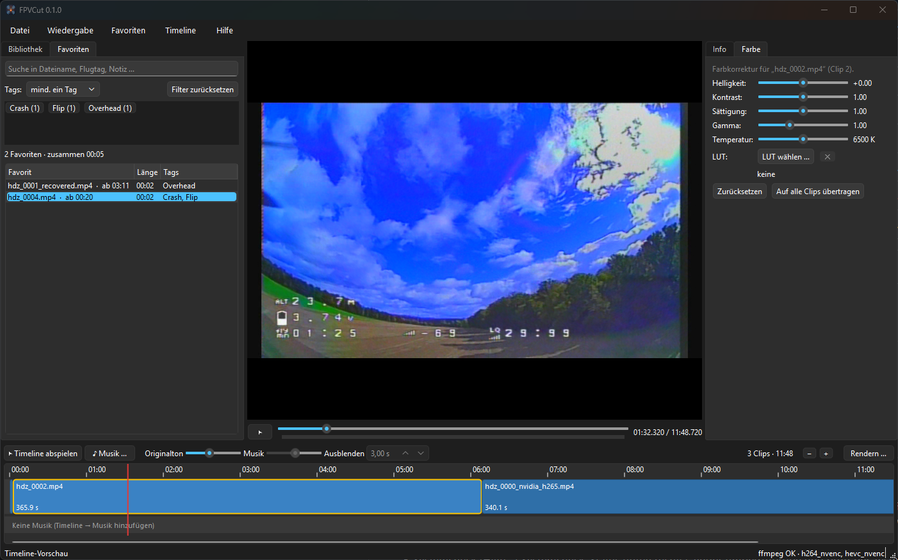

# FPVCut

FPVCut ist ein schlanker Videoeditor für FPV-Aufnahmen. Er bündelt die typischen Arbeitsschritte nach
einem Flugtag in einer Anwendung: Aufnahmen sichten, die besten Szenen als Ausschnitte speichern,
sie in einer Timeline mit Musik zusammenstellen und das Ergebnis mit GPU-Beschleunigung exportieren.



## Funktionen

- **Bibliothek:** Videoordner werden automatisch nach Flugtagen gruppiert. Neue, noch nicht
  gesichtete Aufnahmen sind hervorgehoben. Umbenannte oder verschobene Dateien werden
  wiedererkannt.
- **Sichten und Ausschnitte:** Frame-genaue Wiedergabe, Szenen per In- und Out-Punkt markieren und
  mit Tags und Notizen als Ausschnitt speichern. Die besten lassen sich als Favorit (★) markieren.
- **Ausschnitte-Reiter:** Alle Ausschnitte über alle Flugtage hinweg, filterbar nach Tags,
  Favoriten und Freitext.
- **Timeline:** Clips per Drag & Drop anordnen, trimmen und teilen, eine Musikspur mit
  Lautstärkeregelung und Ausblenden hinzufügen. Die Vorschau läuft ohne vorheriges Rendern.
- **Farbkorrektur:** Helligkeit, Kontrast, Sättigung, Gamma und Farbtemperatur pro Clip, dazu
  3D-LUTs (`.cube`) für D-Log- oder Flat-Profile.
- **Export:** Profile für Originalqualität (H.265), Web (H.264) und Archiv (H.265, 10 Bit).
  Encodiert wird mit NVIDIA NVENC, ohne passende Grafikkarte auf der CPU.
- **Ordner umbenennen:** Flugtag-Ordner lassen sich einheitlich ins Schema `JJJJ-MM-TT_Spot`
  bringen, mit Vorschau und Rückgängig.

## Installation

Voraussetzung ist Windows 10 oder 11 (64 Bit).

1. Unter [Releases](https://github.com/bschaefermeier/fpvcut/releases) das aktuelle
   `FPVCut-…-windows.zip` herunterladen.
2. Das Archiv entpacken und `FPVCut.exe` starten.

Alle benötigten Komponenten (libmpv, ffmpeg) sind enthalten.

> **Hinweis:** Da die .exe nicht signiert ist, zeigt Windows SmartScreen beim ersten Start
> möglicherweise eine Warnung. Über „Weitere Informationen“ → „Trotzdem ausführen“ lässt sich
> FPVCut starten. Alternativ kann FPVCut direkt aus dem Quellcode gestartet oder selbst gebaut werden,
> siehe [Aus dem Quellcode starten](#aus-dem-quellcode-starten).

Für ein Update wird der Programmordner durch die neue Version ersetzt. Bibliothek, Ausschnitte und
Projekte bleiben dabei erhalten.

## Bedienung

### Erste Schritte

1. Über **Datei → Bibliotheksordner hinzufügen** den Ordner mit den Aufnahmen wählen. FPVCut
   erkennt Flugtage am Datum im Ordnernamen, z. B. `2026-08-28_Wiese` oder `28_08_26_Wiese`.
2. Ein Video per Klick öffnen, Szenen mit **I** und **O** markieren und mit **F** als Ausschnitt
   speichern. Alternativ einen Bereich auf der Leiste unter der Zeitleiste ziehen und mit dem
   Speichern-Knopf rechts neben der Zeitleiste sichern.
3. Ausschnitte aus dem Reiter **Ausschnitte** in die Timeline ziehen, optional Musik hinzufügen und
   mit **Strg+R** exportieren. Mit **Strg+S** wird das Projekt gespeichert.

### Tastenkürzel

| Taste | Funktion |
| --- | --- |
| Leertaste | Wiedergabe / Pause |
| ← / → | Ein Frame zurück / vor |
| Umschalt + ← / → | 1 Sekunde zurück / vor |
| J / L | 5 Sekunden zurück / vor |
| I / O | In- / Out-Punkt setzen |
| F | Auswahl als Ausschnitt speichern |
| Umschalt + F | Ganzes Video als Ausschnitt speichern |
| Esc | Auswahl aufheben, Vollbild beenden |
| F11 oder Doppelklick | Vollbild |
| E | Auswahl zur Timeline hinzufügen |
| S | Clip am Abspielkopf teilen |
| Entf | Ausgewählten Clip entfernen |
| P | Timeline abspielen |
| Strg + ← / → | Anfang / Ende der Timeline |
| Strg + Z / Strg + Y | Rückgängig / Wiederholen |
| Strg + R | Rendern |
| Strg + N | Neues Projekt |
| Strg + S | Projekt speichern |
| F5 | Bibliothek neu einlesen |

## Daten und Sicherung

FPVCut verändert die Videodateien nicht. Bibliothek, Ausschnitte und Tags werden unter
`%APPDATA%\FPVCut` gespeichert. Die Timeline wird dort laufend zwischengespeichert, auch wenn das
Projekt noch nicht gespeichert wurde; Projektdateien (`.fpvcut.json`) liegen, wo man sie speichert.

Ausschnitte, Tags und der Sichtungsstatus werden beim Start und Beenden automatisch gesichert; die
Sicherungen der letzten 30 Tage liegen unter `%APPDATA%\FPVCut\sicherungen`. Zusätzlich lassen sich
die Ausschnitte über **Datei → Ausschnitte exportieren** an einem beliebigen Ort sichern und über
**Ausschnitte importieren** wieder einlesen. Startet FPVCut mit einer leeren Bibliothek, bietet es an,
die letzte Sicherung wiederherzustellen.

## Aus dem Quellcode starten

### Voraussetzungen

- [uv](https://docs.astral.sh/uv/) als Paketmanager für Python
- [ffmpeg](https://www.gyan.dev/ffmpeg/builds/) mit NVENC-Unterstützung
- `libmpv-2.dll` aus einem `mpv-dev-x86_64`-Paket von
  [mpv-winbuild-cmake](https://github.com/shinchiro/mpv-winbuild-cmake/releases)

### Einrichtung

```powershell
# uv installieren
powershell -ExecutionPolicy ByPass -c "irm https://astral.sh/uv/install.ps1 | iex"

# Repository klonen und Abhängigkeiten installieren
git clone https://github.com/bschaefermeier/fpvcut.git
cd fpvcut
uv sync
```

`libmpv-2.dll` gehört nach `vendor\mpv\`, `ffmpeg.exe` und `ffprobe.exe` nach `vendor\ffmpeg\`.
Alternativ wird ffmpeg auch über den `PATH` gefunden.

### Starten

```powershell
uv run fpvcut
```

### Tests

```powershell
uv run pytest
```

### Windows-Paket bauen

```powershell
uv run --with pyinstaller pyinstaller --noconfirm packaging/fpvcut.spec
```

Das Ergebnis liegt unter `dist\FPVCut\`. Das Vorgehen für neue Versionen ist in
[docs/release.md](docs/release.md) beschrieben.

## Lizenz

FPVCut steht unter der [GNU General Public License v3.0](LICENSE) oder einer späteren Version.
